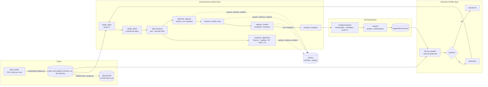

# Arquitectura

## Componentes

| Componente | Herramienta | Dónde |
|---|---|---|
| Entorno y dependencias | `uv` + `pyproject.toml` + `uv.lock` (grupos `train` y `dev`) | raíz |
| Configuración central | YAML + overrides por variables de entorno | `configs/config.yaml`, `src/informalidad/config.py` |
| Validación de datos | pandas (rangos, dominios de códigos GEIH, nulos, tipos) | `src/informalidad/data/validation.py` |
| Feature engineering | `sklearn.Pipeline` (FunctionTransformer + ColumnTransformer) | `src/informalidad/features/` |
| Experiment tracking | MLflow (SQLite local) | `src/informalidad/models/train.py` |
| HPO | Optuna (TPE) con nested runs | `src/informalidad/models/optimize.py` |
| Model Registry | MLflow aliases `candidate` / `champion` | `src/informalidad/models/registry.py` |
| Orquestación y schedule | Prefect 3 (`serve`, cron mensual y semanal) | `pipelines/` |
| API | FastAPI + Pydantic | `src/informalidad/api/` |
| Contenedor | Docker multi-stage, usuario no root, healthcheck | `Dockerfile`, `docker-compose.yml` |
| Monitoreo | PSI + desempeño + equidad, reportes Markdown/JSON | `src/informalidad/monitoring/`, `pipelines/monitoring_flow.py` |
| Calidad | ruff (lint + formato), pytest, pre-commit | `pyproject.toml`, `.pre-commit-config.yaml` |
| CI | GitHub Actions: lint, tests, build y smoke test de Docker | `.github/workflows/ci.yml` |

## Decisiones de diseño

1. **Un solo artefacto para entrenar y servir.** El preprocesamiento vive dentro del `Pipeline`, así
   que la API recibe los códigos crudos de la GEIH y aplica exactamente las mismas transformaciones
   del entrenamiento. Se elimina el riesgo de *training-serving skew*.
2. **Validación fuera de tiempo.** El test son los meses más recientes (ene–feb 2026). Un split
   aleatorio mezclaría meses y sobreestimaría el desempeño real en producción.
3. **Promoción champion/challenger sobre los mismos datos.** El candidato y el champion actual se
   evalúan sobre el mismo test antes de decidir. Comparar contra una métrica guardada de otro mes no
   sería justo (los datos cambian).
4. **Imagen Docker sin MLflow.** La API solo necesita scikit-learn + XGBoost. El champion se exporta
   con joblib a `models/champion/`. Las dependencias de entrenamiento están en un grupo aparte
   (`train`) que no se instala en la imagen. Además se excluye NCCL (librería de multi-GPU que
   XGBoost arrastra en Linux): la imagen pasa de ~700 MB a ~350 MB.
5. **Reentrenamiento mensual**, porque la GEIH se publica una vez al mes; más frecuencia no aporta
   información nueva.
6. **El modelo se serializa con skops en MLflow** (más seguro que pickle; solo carga tipos
   declarados como confiables) y con joblib para la imagen Docker, que solo carga el modelo propio.
